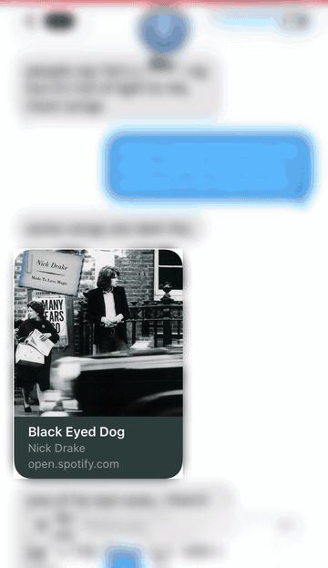

# Spotify to YT Music

An iPhone shortcut that opens Spotify links in **YouTube Music**.

A friend sends you a Spotify song in Messages, but you don't have Spotify. Long-press the link, tap **Share → Spotify to YT Music**, and the same song starts playing in YouTube Music.

<p align="center">
  
</p>

- **Songs** open straight to the matching song in YouTube Music.
- **Albums and playlists** show the track list. Pick a track and it opens in YouTube Music.
- No Spotify account, no API keys, no third-party conversion service. The shortcut talks only to Spotify's public web pages and YouTube Music.

---

## Install (iPhone)

You need iOS with the Shortcuts app (built in) and the YouTube Music app.

1. On your iPhone, open this page in **Safari**.
2. Tap **[Download the shortcut](https://github.com/Marmishurenko/spotify-to-ytmusic/raw/main/Spotify%20to%20YT%20Music.shortcut)**. Safari asks whether to download the file. Tap **Download**.
3. Tap the **download arrow** in Safari's address bar (or open the **Files** app → **Downloads**) and tap **Spotify to YT Music.shortcut**.
4. The Shortcuts app opens with a preview. Tap **Add Shortcut**.

That's it. The shortcut now appears in your Share menu.

> **Installing from a Mac instead:** download the file, double-click it, click **Add Shortcut**. If iCloud sync is on for Shortcuts, it appears on your iPhone automatically. You can also AirDrop the `.shortcut` file to your phone and tap **Add Shortcut**.

## Use it

1. In Messages (or any app), **long-press** the Spotify link.
2. Tap **Share**.
3. Tap **Spotify to YT Music**. If you don't see it, scroll to the bottom of the Share menu, tap **Edit Actions…**, and add it to your favorites.
4. **The first time only,** iOS asks whether the shortcut may connect to `open.spotify.com` and `music.youtube.com`. Tap **Always Allow** for each.

Then:

| You shared | What happens |
|---|---|
| A song | YouTube Music opens and plays that song. |
| An album or playlist | A list of its tracks appears. Tap one and it opens in YouTube Music. |
| Something YouTube Music doesn't have | YouTube Music opens its search page for the song, so you can look for a cover or a live version. |

It should work from any app that can share a link, not just Messages. Messages is the only one tested so far.

## Troubleshooting

**Safari opens instead of the YouTube Music app.**
Long-press any `music.youtube.com` link in Safari and choose **Open in "YouTube Music"** once. iOS remembers the choice.

**It opened the music video rather than the studio recording.**
The shortcut opens YouTube Music's top result for "song title + artist". For some songs, the top result is the official video. It's the right song, just a different version.

**It opened the wrong song.**
Rare, and mostly happens with very generic titles. Please [open an issue](https://github.com/Marmishurenko/spotify-to-ytmusic/issues) with the Spotify link.

**It stopped working entirely.**
The shortcut reads public web pages from Spotify and YouTube Music. If either service changes its page layout, the shortcut may need an update. Check this repo for a newer version, or open an issue.

## How it works

1. **Download the Spotify page** for the shared link. Short `spotify.link/…` links redirect automatically.
2. **Read the page's metadata.** Every Spotify page includes `og:url`, `og:title` and `og:description` tags for link previews. These give the link type (song, album, playlist), the song title and the artist.
3. **Albums and playlists:** download the Spotify *embed* page (`open.spotify.com/embed/playlist/<id>`), which lists every track with its artists, and show them in a **Choose from List** menu.
4. **Search YouTube Music** for `"<title> <artist>"`, take the first result's video id, and open `music.youtube.com/watch?v=<id>`. If no result comes back, open the search page instead.

**Privacy:** the shortcut sends the Spotify link to Spotify and the song name to YouTube Music, and nothing to anyone else. It collects nothing and has no server.

## Build it yourself

The shortcut is generated from [`build_shortcut.py`](build_shortcut.py), so it can be reviewed and changed as code instead of hand-edited in the Shortcuts app. Building needs **macOS** with the Shortcuts app, and you must be signed in to iCloud (Apple requires this for signing).

```sh
git clone https://github.com/Marmishurenko/spotify-to-ytmusic.git
cd spotify-to-ytmusic
./build.sh                 # writes "Spotify to YT Music.shortcut", signed
open "Spotify to YT Music.shortcut"
```

### Testing from the terminal

`./build.sh --test` builds a variant that reads the link from a text file, picks the 2nd list item instead of asking, and prints what it found instead of opening YouTube Music:

```sh
./build.sh --test
open "Spotify to YT Music (Test).shortcut"         # click Add Shortcut once
printf %s "https://open.spotify.com/track/4cOdK2wGLETKBW3PvgPWqT" > /tmp/link.txt
shortcuts run "Spotify to YT Music (Test)" -i /tmp/link.txt -o /tmp/result.txt
cat /tmp/result.txt
# KIND=track | QUERY=Never Gonna Give You Up Rick Astley | FINAL=https://music.youtube.com/watch?v=dQw4w9WgXcQ
```

[`tools/probe_shortcut.py`](tools/probe_shortcut.py) is a small diagnostic shortcut that compares ways of turning a downloaded web page into text. It's how the gotchas below were found.

### Notes for anyone generating shortcuts in code

Things that aren't documented anywhere and cost real debugging time:

- **Text parameters need a `WFTextTokenString`.** Passing a variable to Match Text's `text` (or Replace Text's `WFInput`) as a bare `WFTextTokenAttachment` is silently ignored. At run time, Shortcuts then shows an empty **"Text"** prompt asking the user to type the input.
- **Downloaded HTML is converted to rendered text.** Feeding *Get Contents of URL* into Match Text gives you the visible page text (about 2 KB here), with every `<meta>` tag gone. Renaming the download to `page.txt` with **Set Name** and then running **Get Text from Input** gives you the raw HTML source.
- **YouTube Music returns no results to non-browser user agents.** Send a full Safari `User-Agent` header.
- **Match Text returns *all* matches.** Take **Get Item from List → First Item** before using the result, or you'll end up with several values joined by newlines.
- **The action catalog lives on your Mac.** `~/Library/Shortcuts/ToolKit/Tools-prod.*.sqlite` lists every action's identifier and parameter keys (tables `Tools` and `Parameters`).

## License

[MIT](LICENSE). Not affiliated with Spotify or YouTube.
